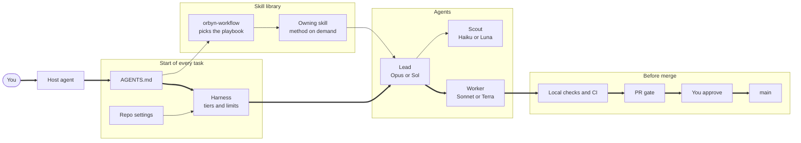
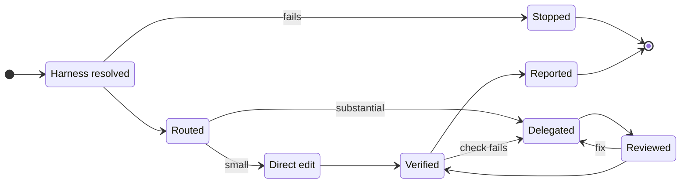
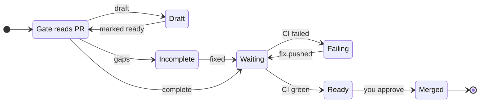

# Orbyn Engineering Skills

**Hand your coding agent the engineering work that repeats, and spend your energy on what only you can decide.**

[](https://github.com/kinqsradio/orbyn-fullstack-skills/actions/workflows/validate.yml)
[](LICENSE)

Coding agents can write code. The rest of the job still falls on you: tracing the
bug, planning the change, picking the model, reviewing the diff, proving it works
and writing it all up.

Orbyn is a free library of 39 connected skills for Claude Code, Codex and Cursor
that hands that work to the agent. You say what you want in plain words. The agent
picks the method, splits the work across the right models, checks the result and
stops for your approval before anything leaves your machine.

Our goal is simple: automate everything that can be automated, so engineers can put
their energy somewhere better.

## Try it

```sh
git clone https://github.com/kinqsradio/orbyn-fullstack-skills.git
```

Open that folder in your agent and paste this, with your repository's URL:

> Set up the nested workspace for `<target repository URL>`. Read our engineering
> policy and the target's own instructions and skills. Preserve existing work,
> clone or safely reconcile the target under `repo/`, check the workspace, and
> complete the setup yourself. Do not install or migrate shared skills into it.

Then ask for ordinary work:

```text
In repo/widget, reproduce this failure and fix it.
Threat-model the new upload feature before we build it.
Draw our stack as a diagram and show how a request moves through it.
```

You don't choose skills or flags. It needs Git and Python 3.11+, installs nothing
into your project, and needs no Orbyn account.

## What you stop doing

| You used to | Now the agent |
| --- | --- |
| Work out which method fits the task | Routes the request to the skill that owns it |
| Read unfamiliar code to find a cause | Traces the source and reproduces the failure |
| Pick models and limits for each job | Reads this repository's settings before it starts |
| Use your strongest model for everything | Leads with Opus or Sol, codes with Sonnet or Terra, and gives mechanical steps to Haiku or Luna |
| Trust a summary of what changed | Reads the real diff and reports what ran and what did not |
| Remember the security review | Threat-models a design, audits source, fixes and verifies separately |
| Write up how a PR was built | Fills in tools, models, sources and evidence |
| Track who to credit | Pins each source to a commit and generates [CREDITS.md](CREDITS.md) |

**You keep the decisions.** Commits, PRs, merges and deployments need your explicit
yes. No file in a repository can grant an agent permission.

## How it works

Every request follows one path, and checks hold it to the rules at each step.



The thick line is one request. Thin lines show what guides it. The [guide](docs/guide.md#full-diagrams) has the full versions of these diagrams.

Each task resolves its repository's settings first, then moves through planning,
delegation, review and verification. You're asked to review it only once
verification and the PR gate have passed.



Children run on the cheapest tier that fits. A scout escalates to a worker and a worker
to a lead, with the reason recorded. If you approve a PR, the gate takes over:



The agent loads only what the job needs, so 39 skills don't crowd its context. Small
edits skip the ceremony. Rules run as code wherever they can, so CI catches drift
that written policy would miss.

## It does more than write code

- **Plan and design:** product discovery, architecture, data migrations, stack choices and statecharts.
- **Build:** APIs, web and mobile UI, AI features and 13 languages.
- **Prove:** tests, CI design, adversarial review and threat models.
- **Investigate:** source tracing, runtime forensics and shipped binaries.
- **Show your work:** architecture diagrams, faux product demos, code-only films and lyric videos, and social posts with previews.

See [every skill](skills/README.md), or start from the [task map](docs/guide.md#start-with-a-task).

## What is proven

Every PR runs the library checks and tests on Python 3.11 and 3.13. We also publish
[small evaluations](docs/guide.md#examples-and-evaluations), including the results
that were weak.

Skills guide an agent; they can't guarantee correct software. Our eval cases are
mostly static, and we haven't measured overall quality gains across models. The
[guide](docs/guide.md) states the limits of each result.

## Use it, adapt it, contribute

Orbyn works with your stack: it reads your schema, rules and owners from your source,
and your project's own instructions always win. The library is MIT licensed, and
we built it from other people's open work, all named in [CREDITS.md](CREDITS.md).

We expect skills to be built with agents, and a PR states how: the tools, models and
sources used. Read [CONTRIBUTING.md](CONTRIBUTING.md) to add yours, and report
vulnerabilities through [SECURITY.md](SECURITY.md).

If this saves you time, star the repository and show someone else what your agent
did. Maintained by [Anh Dang](https://github.com/kinqsradio) for **Orbyn Engineering**.
