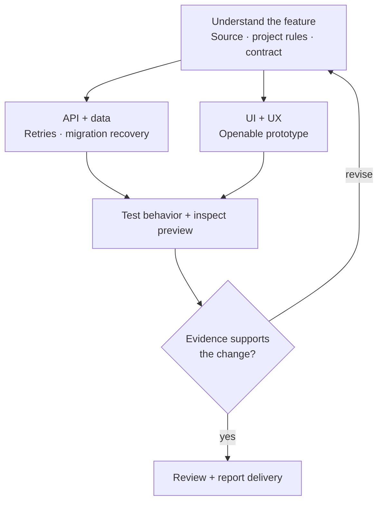
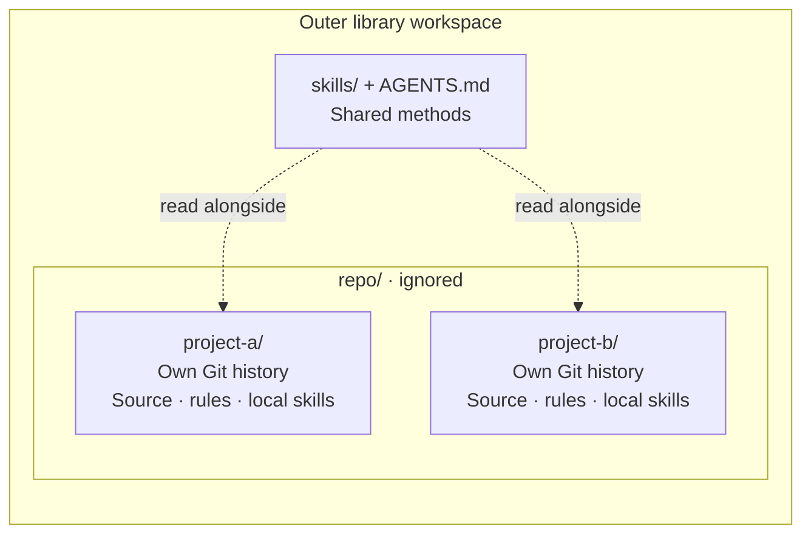
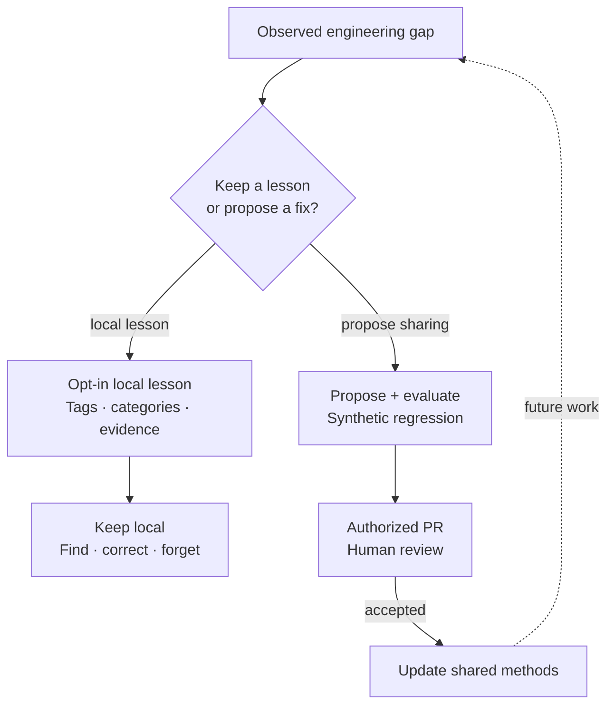

# Orbyn Fullstack Engineering Skills

**A growing library of connected skills for full-stack engineering with Codex, Claude Code and Cursor.**

The catalog currently contains **36 skills** and evolves as real engineering gaps
and contributions identify what is missing.

Product discovery, AI applications, architecture, API design, data migrations,
language-aware implementation, web and mobile UX,
debugging, review, CI and delivery—organized around a feature's complete path
from domain model to user-visible behavior.

[](https://github.com/kinqsradio/orbyn-fullstack-skills/actions/workflows/validate.yml)
[](LICENSE)

Maintained by [Anh Dang](https://github.com/kinqsradio) for **Orbyn Engineering**.

This MIT-licensed fullstack library works in projects beyond Orbyn. Consuming
teams retain their own instructions, stack and company skills; no Orbyn account
is required. Orbyn's own engineering uses its canonical maintained skills, with
reviewed improvements flowing through this public library.

## The approach

**Ground the work → define its contract → change the connected layers → obtain
the right evidence → report actual delivery.**

A feature can involve a shared schema, API, transaction, background job and two
clients. The skills keep ownership and failure behavior visible across that path.
They distinguish a source finding from a runtime observation, a web preview from
native evidence, and a pushed commit from a deployment.



Use the relevant methods and proportionate checks; small changes do not need every
stage.

This is an opinionated engineering workflow, not a claim that prompts guarantee
correct software. [The engineering contract](skills/orbyn-workflow/references/fullstack-contract.md)
explains the handoffs. [The catalog](skills/README.md) lists every skill.

## Start with a task

| Your task                          | Start here                                 | Result                                                   |
| ---------------------------------- | ------------------------------------------ | -------------------------------------------------------- |
| Understand unfamiliar behavior     | `how` / `why`                              | Source trace or documented rationale                     |
| Remember, classify, correct or forget engineering context | `reflect` | Explicit local memory CRUD with scoped tags/categories and evidence |
| Assess a product opportunity or measure its outcome | `orbyn-plan` + `orbyn-research` | Evidence, alternatives and a bounded learning decision |
| Build or evaluate an AI application | `orbyn-ai-application` | Grounding, authorized effects, task-quality evidence and operating limits |
| Deliver a cross-stack feature      | `orbyn-workflow`                           | Owned changes and proportional evidence                  |
| Decide the data/interface model    | `architect`                                | Caller-facing contract and lifecycle                     |
| Implement an API effect            | `orbyn-backend-design`                     | Validation, authority, transaction and client errors     |
| Change a stored format             | `orbyn-data-migration`                     | Compatibility, writer cutover and recovery               |
| Improve web/mobile task flows      | `orbyn-ui-design` + `orbyn-content-design` | Rendered UI with concise product language                |
| Implement across languages         | `language-best-practices`                  | Target-aware local guides and resource/error contracts   |
| Choose a technology stack          | `orbyn-stack-selection`                    | Constraint-led comparison, operating costs and exit path |
| Model TypeScript state             | `language-best-practices`                  | Shared schemas and explicit valid variants               |
| Review a risky patch               | `interrogate`                              | Concrete findings with scenarios and evidence            |
| Build contribution/release CI      | `orbyn-ci-design`                          | Scoped execution and reviewable promotion                |
| Contribute a fix or iterate a PR    | `orbyn-workflow` + `how`                    | Issue intake, reproducible evidence and bounded review/CI iteration |
| Draft a post or carousel           | `social-content` + `social-preview`        | Evidence-backed copy and local visuals                   |
| Review external code/skill updates | `orbyn-upstream-review`                    | Pinned comparison, ignored references and scoped updates |

Twenty engineering principles are now conditional methods under their execution
owners, with essential rules in those owners' entrypoints. They retain their
examples and licenses without adding discovery choices. The default core preset
is a 14-skill reading group; see the [consolidation record](docs/work/skill-consolidation.md). Five REA-related skills are optional specialists for artifact
investigation and REA maintenance, with local methods, recovery/evidence guidance
and [worked examples](skills/reverse-engineer-anything/references/worked-examples.md).
The investigation owner supports local tools first and a compatible REA handoff
when needed. They do not install reverse-engineering tools or upgrade the pinned engine.

## Clone the engineering workspace, then ask your agent

```sh
git clone https://github.com/kinqsradio/orbyn-fullstack-skills.git
```

Open **orbyn-fullstack-skills** as the agent workspace in Codex, Claude Code,
Cursor or your local tool-using agent. Tell it:

> Set up the nested workspace for `<target repository URL>`. Read our engineering
> policy and the target's own instructions and skills. Preserve existing work,
> clone or safely reconcile the target under `repo/`, check the workspace, and
> complete the setup yourself. Do not install or migrate shared skills into it.

**Nested is the default layout.** A person or managing application can instead
[register a target in place](skills/orbyn-setup/references/repository-workspaces.md#in-place-targets).
Targets have independent Git histories:



One maintained library avoids copied shared skills in every target. Agents read
both scopes; project rules
and host permissions still govern their applicable boundaries.

```text
orbyn-fullstack-skills/
├── AGENTS.md
├── skills/
└── repo/
    ├── Orbyn/
    ├── orbyn-wt/
    │   └── save-retry/
    ├── another-project/
    └── another-project-wt/
        └── fix-pagination/
```

| Target repository | Its task worktree |
| --- | --- |
| `repo/Orbyn/` | `repo/orbyn-wt/save-retry/` |
| `repo/another-project/` | `repo/another-project-wt/fix-pagination/` |

Each target has its own sibling `<repo-slug>-wt/` container when worktrees are
needed. The task folder is created with Git and shares its primary repository's
history. Separate targets keep separate histories. Small work can use an already
suitable checkout; setup does not require an empty worktree or a new branch for
every task. Everything under `repo/` stays outside the library's Git index.

The agent uses [orbyn-setup](skills/orbyn-setup/SKILL.md), prepares the workspace,
reads the target's instructions in place and checks both Git roots. You do not
need to invoke each skill, choose installer flags, namespace company skills or
maintain consumer pins. There is no target installation or sync process. Unless
registered in place, existing external checkouts require a coordinated migration that preserves active paths,
private configuration, ignored output and worktrees. Setup never moves them just
to satisfy the layout. See the [setup guide](docs/installation.md).

The outer workspace owns shared skills and host discovery. Target repositories
own their source, contribution policy, existing instructions and skills. A target's
Git boundary or host settings may limit automatic discovery: agents must read the
required local guidance explicitly and distinguish actual host observation from
filesystem checks. Nesting does not override target rules or host permissions.

**A target can own agent instructions now or add them later.** Orbyn may have its
own `AGENT.md`, `AGENTS.md`, `CLAUDE.md` or local skills for application-specific
commands, module owners and verification rules. Agents read that guidance alongside
the outer library's methods. Retiring Orbyn's duplicated installation does not
reserve or ban those filenames. Keep shared methods in this library and project
facts in the target; do not copy the shared policy back into it. Follow the
[instruction contract](skills/orbyn-setup/references/repository-workspaces.md#project-owned-instructions-now-and-later)
when the two sets differ. A future Orbyn instruction file is permitted; this change
does not create one automatically.

Python 3.11+ and Git support the local checks. A local model can use the same
files offline; setup does not install a provider, subscription or runtime. Optional
reading groups select relevant methods without copying files. For isolated work,
use sibling `repo/<project-slug>-wt/<purpose>/` under the
[worktree policy](skills/orbyn-worktree/SKILL.md).

Downloaded upstream research stays in ignored `orbyn-references/` or `openSrc/`.
Neither target repositories nor raw research enters the library's Git index or
public content. Agents [review freshness and selectively improve existing owners](skills/orbyn-upstream-review/SKILL.md).

Then describe ordinary work:

```text
In repo/widget, reproduce this failure using its own contribution rules.
Implement the fix in repo/widget-wt/save-retry and obtain the required evidence.
Write a LinkedIn introduction from these feature notes and preview the carousel.
```

## Bring your own stack

Orbyn uses TypeScript, React, Electron, React Native, API services and PostgreSQL;
those are examples, not prerequisites. The workflow resolves **your** schema,
transport, persistence, component and operational owners from current source.
Use the optional [project context map](skills/orbyn-setup/references/project-context.md)
to point to your existing stack, design, brand and verification guides. The map
belongs to your project and stays outside the public library. See
[stack ownership](docs/agents/stack.md). Framework-specific examples do not
authorize adding that framework to your project.

The optional host model presets describe Orbyn's reference setup, not a required
model purchase. Workspace setup does not apply them. Use the host/model guidance
only when requested and supported by your environment.

## Use it, adapt it, contribute back

You can use, modify and redistribute the MIT-licensed material with the required
notices. Company conventions and existing skills stay in their target repository's
[established paths](skills/orbyn-setup/references/project-skills.md), separate
from the shared library. Read and adapt both guidance sets without moving or
replacing upstream instructions. The [offline contract](skills/orbyn-setup/references/offline.md) keeps instructions
and licensed source references available locally. To contribute, fork this repository, create a branch,
make a focused change, run validation and open a pull request here. New skills
need a concrete routing gap and a useful input/output contract.

[CONTRIBUTING.md](CONTRIBUTING.md) covers skill changes, provenance and checks.
[Workspace ownership](docs/synchronization.md) explains the single-source model:
shared methods change in this library, while target code and project policy change
in their independent nested repository. A public library merge requires no target
pin update. Report the library revision used for evidence and coordinate updates
without discarding another session's local work.

When current work reveals a demonstrated reusable gap, the agent can prepare a
concrete proposal and ask once whether you want a **public PR**, **a local patch
to review first**, or **keep it local**. No special reflection invocation or
manual PR drafting is needed. The
[feedback policy](skills/orbyn-skill-creator/references/contribution-feedback.md)
keeps your main task moving, respects declines and existing specific permission,
and keeps company-only material local. Public improvements use synthetic examples
and preserve applicable credits. This is optional contribution, not telemetry
or automatic cross-user learning; silence does not upload anything, and a public
merge does not authorize changing your target repository.



Local memory is optional; a contribution can start directly from a demonstrated
gap. Use synthetic examples
and relevant checks, with paired trials when assessing changed agent behavior.
Human review precedes a shared update; neither capture nor merging is automatic.

## Examples and evaluations

Optional [local engineering memory](skills/reflect/references/memory.md) supports
explicit remember/find/update/archive/forget requests, categories, domains and
namespaced tags. It works offline with Python/SQLite and private JSON, Markdown
or HTML review exports. Memory stays outside Git and host-native stores; ordinary
setup does not enable capture. Selected lessons can become reviewed local patches
or authorized fork contributions through the existing skill owners. No automatic
model learning, background collection or remote upload is included.

Start with the worked examples for [architecture](skills/architect/examples/proposal-approval.md),
[backend effects](skills/orbyn-backend-design/examples/retry-safe-effect.md),
[data migration](skills/orbyn-data-migration/examples/session-cutover.md),
[UI recovery](skills/orbyn-ui-design/examples/failed-save.md) and
[social writing](skills/social-content/examples/engineering-update.md). Each shows
synthetic inputs, a useful result and a concrete failure to avoid. An optional
[task record](skills/orbyn-workflow/references/task-record.md) connects decisions,
verification and continuation without a second project tracker.

For costly lifecycle/concurrency rules, the [optional checked statechart workflow](skills/architect/references/statechart-compiler.md)
uses bundled pinned compiler source with explicit local prerequisites. The
[runnable two-worker job](skills/architect/examples/leased-job/guide.md) shows a
stale-completion bug, fixed bounded check, real-method replay and generated
HTML/SVG preview. No automatic tool installation or production-proof claim.

For optional colour direction, the [semantic-colour guide](skills/orbyn-ui-design/references/colour-palettes.md)
and [offline gallery](skills/orbyn-ui-design/examples/colour-gallery/guide.md)
separate reference hex labels, derived light/dark roles and per-context contrast
checks. Existing project brands win; no automatic theme adoption or accessibility
certification is implied.

Routine work relies on its diff, PR and CI. When a long task or handoff needs a
checkpoint, the agent maintains the minimum useful project-owned record without
another human invocation. The template includes helpers and synthetic examples;
actual task logs and raw traces stay outside public library content in the consumer's
approved local output or CI artifacts. Workspace setup creates no target logging directory.

The [evaluation toolkit](skills/orbyn-skill-creator/references/evaluations.md)
contains versioned routing and outcome cases with review rubrics. Prepare
frozen tasks, capture trials in an authorized host, grade evidence and compare a
complete baseline/candidate pair. Missing trials stay unverified. These are tools
for measurement. The [23 October Codex evaluation](docs/evaluations/2026-10-23-codex.md)
records 17/17 routing and 5/5 artifact passes against a previous-library baseline
of 16/17 and 5/5. It supports one routing correction, with explicit trial limits;
it does not establish general model improvement or Claude runtime behavior.

The [24 October setup and handoff trials](docs/evaluations/2026-10-24-setup-handoffs.md)
compare six focused cases against the released library. The final candidate
passed 1/1 routing and 5/5 outcome cases versus 1/1 and 4/5 at baseline. The
corrected recovery answer explicitly states crash/power-loss limits. Earlier
failures are retained in the report and full captures stay in ignored local output.
These are single-run development results with unblinded lead grading, not
independent qualification.

The [25 October contribution assessments](docs/evaluations/2026-10-25-contribution.md)
record 12 passing outcomes and one underspecified, unverified case in each
condition. Expected-owner body reads were 9/13 at baseline and 13/13 with the
new workflow. A separate clarified-case pair passed 1/1 in both conditions.
These observations support connected routing, not an outcome-quality gain or
end-to-end contribution qualification.

The [disposable contribution execution study](docs/evaluations/2026-10-25-contribution-execution.md)
then exercised real reproduction, fixes, tests, commits, local pushes and paginated
PR feedback. Both conditions eventually produced correct outcomes in 2/2 trials;
the corrected candidate also stopped dependent pushes after a failed commit in
2/2, versus 0/2 at baseline. The local PR service is a controlled offline fixture,
and an earlier host-blocked worktree experiment is reported separately. These
small development trials do not qualify hosted GitHub behavior.

The [bulk CI and release exercise](docs/evaluations/2026-10-25-bulk-ci.md) adds
offline indexed failure analysis and artifact-bound stage verification. It ran
54,000 actual fixture testcases across 18 slots and separately measured up to
one million generated records, including 500,000 candidate failures. The complete
failure export is independent of the compact top-group summary. These local
capacity/evidence checks do not establish live-agent or production qualification.

For substantive continuation, the optional [handoff contract](skills/orbyn-workflow/references/handoffs.md)
records scope, candidate, ownership, observed checks and next action. Its offline
checker rejects stale revisions and inconsistent completion claims; receiving
agents still inspect the actual evidence. Small tasks do not need a packet.

Every external source this library uses is listed in [CREDITS.md](CREDITS.md).

CI validates metadata, references, attribution, catalog/discovery consistency,
the distribution manifest and helper/synchronization behavior. It does not prove
live model routing, rendered design quality, native UX or production correctness.

## License

Original Orbyn material is MIT licensed. Applicable support-file licenses,
copyrights and provenance are preserved in [LICENSE](LICENSE),
[AUTHORS.md](AUTHORS.md), [provenance.json](provenance.json) and
[license notices](tools/THIRD_PARTY_NOTICES.md). Orbyn branding identifies this
project; it does not imply endorsement of forks or third-party services.

Report bugs with the issue forms. Report vulnerabilities privately using
[SECURITY.md](SECURITY.md); do not include credentials or private project content
in an issue or PR.

## Language-aware engineering and stack decisions

Use the library with JavaScript, Python, Go, Rust, Java, Kotlin, C#, Swift, C,
C++, SQL and shell projects, plus the existing TypeScript contract guidance.
The [language skill](skills/language-best-practices/SKILL.md) loads a focused local
guide for the affected code; [stack selection](skills/orbyn-stack-selection/SKILL.md)
compares project constraints, primary evidence, operating costs and migration paths.
The agent routes these from the task; no separate skill invocation is required.
Guidance and worked examples run from disk; current online support/pricing still
requires verification. Contribution work stays local/private until deliberate
publication under the [fork policy](skills/orbyn-worktree/SKILL.md).

## Contribution workspaces

Use only ignored `repo/<project>/` and sibling `repo/<project-slug>-wt/<purpose>/`
paths for targets. The agent completes setup without an installation-layout
question. Preserve existing external paths until a coordinated migration is
safe and authorized. Nested targets keep independent Git histories and their own
instructions/skills, outside library commits. Read both sets of guidance under
the [workspace contract](skills/orbyn-setup/references/repository-workspaces.md).
The library has one shared skill source; no target installation or repinning follows.

## Production best practices

The existing owners also cover maintainable modules, polyglot contracts, bounded
APIs and pagination, retry-safe effects, privacy-aware diagnostics, useful test
boundaries, async UI recovery and consumer-owned verification recipes. TypeScript
lives beside the other language guides under language-best-practices; its retired
reading-group alias resolves to that owner without creating another active skill.
The agent selects the relevant methods from the task and preserves project policy.

For Expo/RN and EAS tasks, the [mobile engineering index](skills/orbyn-workflow/references/mobile-engineering.md) selects existing runtime, UI, architecture, API, verification and release owners. Ordinary [motion](skills/orbyn-ui-design/references/motion.md), [mobile web](skills/orbyn-ui-design/references/mobile-web.md) and [adverse fixtures](skills/orbyn-ui-design/references/stress-fixtures.md) remain conditional; no plugin installation or consumer migration is required.
