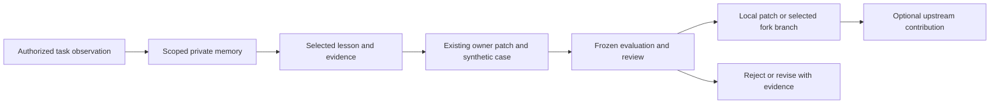

# Local memory and evidence-led skill improvement

Status: original design with local implementation checkpoint below, 25 October
2026. The optional runtime and routing are implemented in the uncommitted candidate;
this document does not enable real memory capture or host configuration. Library baseline: `0bb824e0a84281e72abda6f86545dc792101de5d`.

For current scope selection, use the [owning memory contract](../../skills/reflect/references/memory.md#select-retrieval-scope-before-querying):
select the authorized project store and checkout applicability before retrieval.
The [action-level instruction coverage proposal](action-level-instruction-coverage-research.md)
researches stronger request/execution evidence separately; it does not add another
memory store, enable capture or implement an enforcement harness.

## Decision

Extend this library with an optional local memory service implemented first as an
on-demand command-line helper. Keep private records outside Git. Let people
remember, find, correct, classify, archive and forget records through natural
language or explicit commands. Turn selected, evidenced lessons into ordinary
reviewable changes to the existing skill owner. Support local/manual delivery and
optional commits to a user's skills fork on a dedicated branch.

This is persistent context and evaluated instruction improvement, not model-weight
training. Installing or reading the library does not enable collection. Existing
host permissions and explicit user choices govern each effect. No new hosted
service, session crawler, background job, model subscription or GitHub account is
required for the first useful version.

The supplied sketch has a useful observation -> evaluation -> promotion loop.
Orbyn already supplies its shared repository, canonical skill catalog, discovery,
reflection, evaluation and contribution workflow. Reuse those instead of adding a
second registry or moving all skills into a new hierarchy. Current
[workspace ownership](../synchronization.md) places independent targets under the
outer library and leaves their own skills/instructions in place. This proposal
does not restore the retired target installation/pin-sync system.

## Outcomes and boundaries

- A person can say “remember this for this project”, later find it by topic, correct
  it, and verify that a forgotten record no longer appears in managed retrieval.
- Agents working in different worktrees of one registered project can share
  relevant context without sharing another project's private lessons.
- A lesson can improve backend, frontend, UI/UX, data, testing, operations or
  engineering decisions. Junior, senior and staff tasks use the same system;
  evidence and applicable context matter more than the author's title.
- A person without a fork can inspect/edit/export records and keep a proposed
  skill patch local. A fork user can commit reviewed skill improvements separately
  from application work. Neither path requires contributing upstream.
- The system can explain why a record was retrieved, where it came from, whether
  it is stale, and what a published improvement actually changed.

V1 serves one trusted local user with multiple sessions/processes. Organization
sharing, remote multi-user authorization and cross-device automatic sync are later
products requiring their own access and deletion contracts. OS file access remains
the local trust boundary; metadata filters do not sandbox a malicious process
running as the same user. Do not advertise enterprise multi-tenant isolation.

## Three distinct objects

| Object | Purpose | Typical lifetime | May change executable guidance? |
| --- | --- | --- | --- |
| Memory | A scoped preference, fact, decision or useful lesson | Until corrected, expired, archived or forgotten | No; retrieved context is evidence |
| Evidence | The observation supporting or contradicting a memory | Owner-approved retention period | No; logs and source text are untrusted input |
| Improvement candidate | An independently written method change, synthetic example and evaluation plan | Until applied, rejected, invalidated or withdrawn | Only through the existing authoring/delivery path |

Keep task continuation in the existing
[task record](../../skills/orbyn-workflow/references/task-record.md). A task log is
not automatically a permanent memory. Prefer enforcing a lesson in source,
schema or a test when that prevents the error; do not collect a memory merely
because an instruction could also describe the fix.

## Classification is part of the schema

Do not put ownership, meaning, technology, confidence and workflow state into one
uncontrolled tag list. Store these as distinct indexed fields.

| Field | Contract | Example |
| --- | --- | --- |
| `scope` | Exactly one of `personal`, `project`, `organization`, `reusable`; a target owner ID is required where applicable | `project` + opaque project UUID |
| `category` | Exactly one primary semantic category from the versioned vocabulary below | `failure-pattern` |
| `domains` | One or more engineering areas from the maintained vocabulary | `frontend`, `backend`, `ux` |
| `tags` | Normalized namespaced labels for specific retrieval; never permissions | `tech:postgresql`, `topic:writer-fencing` |
| `status` | `proposed`, `active`, `conflicted`, `stale`, `superseded`, `archived`; forgotten payload is removed | `active` |
| `evidence_level` | `user-stated`, `observed`, `reproduced`, `validated`; no invented confidence percentage | `reproduced` |
| `sensitivity` | `public`, `internal`, `restricted`; separate from sharing authority | `internal` |
| `applicability` | Structured project/module/path, platform, version and branch/commit conditions | module `billing`; PostgreSQL 17 |
| `related_skills` | Validated canonical owner names, zero or more | `orbyn-data-migration` |
| `relations` | Typed ID links: `supports`, `contradicts`, `supersedes`, `derived-from` | correction supersedes previous record |

Initial categories: `preference`, `project-fact`, `decision`, `convention`,
`workflow`, `failure-pattern`, `solution-pattern`, `constraint`, `learning`.
An improvement candidate is a different object, not another category. Unknown
information is a proposed record with an explicit question, not an active fact.

Initial domains: `architecture`, `backend`, `frontend`, `ui`, `ux`, `accessibility`,
`data`, `security`, `testing`, `performance`, `platform`, `operations`, `delivery`,
`developer-experience`, `technical-strategy`. Multiple domains are useful for a
single end-to-end lesson; do not force UI/API failures into one technical silo.

Tag prefixes: `tech:`, `topic:`, `concern:`, `platform:`, `module:`. Lowercase
kebab-case values, unique within a record, maximum 12 tags and 64 characters per
tag for the initial contract. Seed a small alias map such as `tech:postgres` ->
`tech:postgresql`; do not silently merge terms merely because they look similar.
Custom tags are allowed inside their owning scope. Project module names and tag
counts can themselves reveal private context; filtering applies to facets too.

Categories/domains have stable IDs, display labels, descriptions and a taxonomy
version. Add/rename/deprecate changes require an explicit mapping and preview of
affected records. Reject unknown category IDs on import until mapped. Preserve
unknown imported labels as quarantined metadata for review rather than dropping
them. Merge aliases transactionally, preserve record IDs and rebuild search.
Avoid categories for every language or one tag for every project. Project ID,
scope and applicability already carry those dimensions.

`reusable` means suitable for consideration across authorized contexts, not public
or globally discoverable. Changing a scope or sensitivity label cannot grant
access or publication permission. Widening scope creates a reviewed new record;
it cannot silently move the original private record into a broader store.

## Storage and ownership

Ship code, schemas, taxonomy defaults, synthetic examples and evaluation cases in
this library. Store real records in an explicitly selected user-owned data root
outside the library and target checkouts. Resolve an appropriate platform user
data directory during opt-in setup and report its actual location. An explicit
private location wins; reject public/export directories and accidental symlink
escapes. Do not write to Codex/Claude memory directories as a side effect.

Proposed runtime layout (not directories created by this design):

```text
<user-data>/orbyn-learning/
  settings.json                    # user-approved modes and local bindings
  registry.json                    # opaque store/project IDs and private paths
  stores/<store-id>/memory.sqlite3  # canonical records, relationships, taxonomy
  exports/<export-id>/              # explicit private exports and edit drafts
  candidates/<candidate-id>/        # local evidence and proposed patch metadata
  deletion-ledger/                  # minimal suppression IDs; no remembered text

orbyn-fullstack-skills/
  skills/reflect/references/...     # capture, classification, recall, forgetting
  skills/orbyn-skill-creator/...    # evaluate and promote selected lessons
  tools/learning/...                # proposed helper and portable schemas
  tests/...                        # synthetic contract/regression tests
```

Use separate stores for personal and individual projects. A local registry binds
the authorized active target to its store, never a field supplied by an imported
memory. Resolve the target's own Git root even when the outer library is the host
workspace. Git common-directory identity groups worktrees; a stored project UUID
survives an explicitly reconciled move. New clones/forks with matching names or
remote URLs do not automatically inherit access. Non-Git directories can be
registered explicitly. Store no credentials in repository identities.

Organization policy can be linked/read in its existing project location. V1 does
not create a writable shared organization database. Personal preferences may be
selected alongside one project's store only when the user permits that union.
Cross-project reusable records use a separately approved store; project lessons
are not silently pooled. Plain local databases are not application-encrypted;
honor OS access controls and owner backup policy without claiming encryption.

## Engine choice and concurrency

Recommend Python 3.11+ using the standard library and SQLite, consistent with
existing library helpers. One canonical database per store; JSON/Markdown are
explicit import/export and edit formats, not a second live source of truth.
SQLite supports transactions across the record, labels, relations and audit
metadata, with one writer at a time. Handle contention explicitly rather than
assuming concurrent file rewrites are atomic.
Source: [SQLite transactions](https://sqlite.org/lang_transaction.html).

| Alternative | Reason to choose or defer |
| --- | --- |
| Markdown/JSON files as the live store | Easy to read, but multi-record updates, deletion, concurrent agents and taxonomy changes require a transaction protocol; retain as portable exports |
| SQLite with a small on-demand helper | Selected: local, transactional, no daemon/account, supports deterministic filters and bounded search |
| Hosted vector database/MCP service first | Defer: adds operating/access/sync/deletion costs before lexical recall has been measured |

Module boundaries: schema/taxonomy validation; local authorization and project
resolution; transactional repository; retrieval; candidate packaging; host adapter.
Memory storage never invokes Git/network/model APIs. Delivery never scans the
memory directory to decide what to commit. Both use explicit validated inputs.

Every mutation takes an expected revision and a unique operation ID. In a short
transaction, validate current authorization and the record revision, apply the
change, update relationships/search generation and retain a content-minimal
receipt. Concurrent correction fails with a conflict and current revision; do
not last-write-wins merge prose. Retry the same operation ID only with the same
request fingerprint, retained privately as a keyed digest. Changed payload returns
a conflict. Forget removes related digests and leaves only operation/record IDs
needed to reject old retries as forgotten; do not preserve a hash oracle for the
deleted statement. Do not hold a write
transaction while waiting for a model, editor, network or human response.

SQLite busy responses receive bounded retry/backoff; a failed commit is not a
successful memory write. A terminated write must leave either complete old or
complete new state. All writers check schema compatibility inside the transaction;
old clients refuse newer schemas. Migrations take the write lock, validate the
version and update schema/data together where possible. Recovery uses checked
backups and preserves the deletion ledger; incompatible downgrade is refused.

Start with bounded lexical search and metadata indexes. No embedding provider or
FTS dependency is required initially. If scale measurements justify FTS/vector
search, treat its index as rebuildable and add deletion/source-version tests
before enabling it. V1 local-file operation does not support placing a live
database on a network share for cross-device synchronization.

## Record and CRUD contract

Required data: schema version, opaque record ID, revision, owner/scope binding,
title, concise statement, classification fields, applicability, evidence pointers
and their observed revisions, creation/update time, optional `review_after` and
`expires_at`, and typed relationships. Source pointers are private metadata;
never automatically copy their contents. Commands in a record are inert text.

Synthetic user-facing record:

```json
{
  "schema_version": 1,
  "id": "mem_example_001",
  "revision": 2,
  "scope": {"kind": "project", "owner_id": "project_example"},
  "category": "failure-pattern",
  "domains": ["frontend", "backend", "ux"],
  "tags": ["tech:react", "topic:async-save", "concern:data-loss"],
  "title": "Keep edits made while a save is pending",
  "statement": "The save response confirms the submitted snapshot; retain any newer unsaved input.",
  "status": "active",
  "evidence_level": "reproduced",
  "sensitivity": "internal",
  "applicability": {"modules": ["editor"], "platforms": ["web"]},
  "related_skills": ["orbyn-ui-design", "orbyn-backend-design"],
  "evidence": [{"kind": "test", "ref": "synthetic:test-pending-edit", "revision": "fixture-v1"}],
  "relations": [],
  "created_at": "2026-10-25T00:00:00Z",
  "updated_at": "2026-10-25T01:00:00Z",
  "review_after": "2027-01-23T00:00:00Z",
  "expires_at": null
}
```

The schema must also cap field/record/import sizes, reject duplicate IDs, invalid
UTF-8, malformed timestamps, unknown schema versions and unsafe source paths.
Validate expiry ordering, related skill names and same-scope relation targets.
External evidence unavailable at recall is explicitly unverified.

| User action | Required behavior |
| --- | --- |
| Remember | Resolve authorized scope; create a record or surface a likely duplicate; show what was stored and where |
| Find/show | Apply scope/status/applicability before ranking; show IDs, revision, evidence and freshness |
| Correct/update | Show current and proposed text; use expected revision; invalidate affected candidates and stale citations |
| Retag/recategorize | Validate vocabulary; preview affected IDs for bulk edits; change metadata transactionally |
| Archive | Reversible removal from ordinary recall; explicitly distinguish from forgetting |
| Forget | Suppress immediately, remove payload and managed derivatives, produce an honest deletion receipt |
| Export/import | Explicit destination and records; imports start quarantined/proposed, cannot grant access or overwrite a newer revision |
| Propose improvement | Produce a selected owner patch and synthetic regression; no write to released skills merely from recall |

An evidence correction may update the same ID/revision. A competing claim is a
linked contradiction; a materially different replacement can supersede the old
record. Never upgrade `user-stated` to `validated` because the agent repeated it.
Repeated reads are not independent evidence. Explicit human preference is useful
as user-stated context without pretending to be an experimentally validated fact.

## Capture modes and host integration

Separate capture from delivery; “automatic” must not bundle unrelated effects.

| Capture mode | Behavior |
| --- | --- |
| Off | No store reads/writes or collection; normal current-task work continues |
| Manual, recommended initial mode | Explicit “remember/update/forget” requests operate locally; no background extraction |
| Assisted, explicit later opt-in | Offer or save bounded current-task observations in approved scopes as proposed records, subject to the host's per-write rules |

Record any opt-in in the user-owned configuration only when expressly authorized.
An opt-in cannot override a host that requires direct authorization for each
persistent write. This design discussion does not authorize capturing this chat
or changing the host's existing memory. Turning capture off does not itself delete
existing records; the UI distinguishes disable from forget-all.

The agent resolves natural-language requests to the helper, validates results and
reports actual effects. No need for the human to invoke a sequence of skills or
learn flags. The helper supplies structured results and readable previews for
manual users. If Python/the helper is unavailable, provide a user-selected local
draft/export; do not claim searchable persistence, synchronization or CRUD ran.

Host-native memory is a separate owner. Detect/report capabilities, then use an
explicit optional adapter with its own supported API, permission, retention and
deletion contract. Do not scrape or mirror all host transcripts, edit plugin
caches, install hooks, enable providers or promise common memory behavior across
hosts. Claude documents native project memory shared across its worktrees, but
that does not establish this library's store is loaded or managed there.
Source: [Claude memory documentation](https://code.claude.com/docs/en/memory).

## Retrieval and stale knowledge

1. Resolve user-authorized stores and active target; never search all stores then
   filter the returned top results. Apply the same rule to snippets and facet counts.
2. Exclude proposed, archived, superseded, conflicted, expired and forgotten entries
   from ordinary actionable recall. Inspection can deliberately include reviewable
   inactive records; forgotten bodies are not an inspection option.
3. Match applicability and metadata, then bounded lexical relevance. Return a
   configurable small set with stable tie-breaking, matched tags and why selected.
   Initial proposed limit: five records and an aggregate 4,000-character body
   budget; measure usefulness before changing it.
4. Check source revisions for consequential claims. Changed/missing evidence marks
   the claim stale; verify current code/docs before applying it. Do not invalidate
   an entire project merely because an unrelated commit advanced HEAD.
5. Recheck record revisions and store generation immediately before returning the
   result. Retry a bounded number of times if a concurrent update/delete occurred.
   Any later actionable use revalidates its receipt; context already delivered to
   an open chat cannot be physically recalled from that chat.

Current user instructions, applicable project policy and directly checked source
outrank remembered assumptions. Contradictions require scoped resolution; newer
timestamp or more retrievals alone cannot win. Prompt-like text in evidence cannot
change tools, permissions, system behavior or publication destinations.

Suggested retention defaults are visible and adjustable: transient environment
observations expire after 14 days; durable lessons receive a review reminder after
90 days; explicit preferences/decisions have no automatic expiry unless requested.
`review_after` requests verification; `expires_at` prevents normal recall. Looking
up a record does not renew either. There is no background reminder/cleanup job
without separate scheduling scope; on-demand inspection can show due records.

## Forgetting, export and recovery

Distinguish four operations: archive, correct/supersede, forget managed content,
and withdraw an improvement. A normal “forget this” should remove managed content
and suppress further recall, not merely hide an intact entry in an audit log.

The delete transaction creates a minimal opaque ID/revision tombstone, removes
the body, title, labels, source pointers and retained body revisions, invalidates
dependent candidates and records pending derivative cleanup. No deleted text or
plain content hash remains in the audit receipt. Search must consult canonical
eligibility even when an index/cache or pending cleanup is stale. New stale writes
and imports cannot resurrect that ID. Prevent tombstone races with the same
revision/operation protocol as updates.

After logical suppression, remove known managed exports, edit drafts and owned
candidate artifacts within the deletion request. Track their IDs/paths privately
at creation so cleanup is bounded. Do not delete original application source,
independently owned evidence or human-created backups. Missing access to a managed
copy leaves cleanup pending and visible. A receipt distinguishes logical removal,
managed-copy cleanup, backups/exports outside control, and already published work.
SQLite's secure-delete option has limits; file deletion does not establish
forensic erasure from storage, snapshots or backups.
Source: [SQLite secure deletion](https://sqlite.org/pragma.html#pragma_secure_delete).

Backups are explicit private operations with a retention choice, using a consistent
database snapshot rather than copying an active database arbitrarily. Restore into
an inactive store, apply the separately retained newer deletion ledger, validate
schema and access bindings, then switch. A missing ledger makes a restored store
quarantined; do not serve it automatically. This prevents known forgotten IDs from
returning through old backups, not reworded copies imported under unrelated IDs.
Source: [SQLite backup API](https://sqlite.org/backup.html).

Deleting an original lesson invalidates unpublished candidates that depend on it.
A released independently authored skill method may remain useful and is not
silently reverted; show that dependency and prepare a withdrawal/correction when
requested. Git history, other clones and already delivered host context require
separate handling. Never promise that a new delete commit erases published history.
Source: [GitHub removal guidance](https://docs.github.com/en/authentication/keeping-your-account-and-data-secure/removing-sensitive-data-from-a-repository).

## From memory to a better skill



Use the existing [reflection method](../../skills/reflect/SKILL.md),
[contribution policy](../../skills/orbyn-skill-creator/references/contribution-feedback.md)
and [evaluation guide](../../skills/orbyn-skill-creator/references/evaluations.md).
A candidate records the observed failure, working correction, applicability and
nearby non-applicable case, skill owner, source-library commit, exact proposed
diff hash, source memory revisions, evidence limits and validation result.

Candidate state: draft -> evaluated -> ready -> applied locally / published /
accepted, or rejected / invalidated / withdrawn. Store these as explicit outcomes;
“published” does not imply merged, adopted or improved. Changed source memories,
base tree or patch invalidate the evaluation until reconciled.

Generalize with independently written text and synthetic fixtures. Removing names
from a private transcript is insufficient. Never include real memory IDs, private
module labels, evidence paths or candidate lineage in a public patch; keep that
mapping local. Scope/tags/sensitivity are routing hints, not proof of licensing,
secrecy or permission. A public-candidate screen shows the complete outgoing files,
destination and checks. Preserve third-party provenance where applicable.

Evaluate the lesson against a failing case, an adjacent non-trigger and a
counterexample that would reveal overgeneralization. Hold out additional cases
before seeing candidate behavior. Real paired model trials need explicit scope,
pinned host/settings and retained failures. Static checks alone cannot prove
self-improvement. Apply fixes to existing skill owners; do not add a universal
rule to every entrypoint after one failure.

## Manual and fork delivery

| Delivery mode | User receives | Remote effect |
| --- | --- | --- |
| Manual/local, default | Readable proposed changes plus a base-bound patch and evidence summary; no GitHub required | None |
| Local Git commit | Selected skill changes committed to an owned `fix/learning-<topic>` or `docs/learning-<topic>` branch/worktree | None |
| Personal fork branch | Selected reviewed changes committed and, when authorized, pushed to one verified fork branch | Public for this library's GitHub forks |
| Upstream contribution | Reviewed PR targeting the canonical library, using existing contribution rules | Only within explicit publication scope |

Follow the current repository's purpose-based branch policy; the initial helper
defaults to `fix/learning-<topic>` or `docs/learning-<topic>` as appropriate. Keep one
branch per coherent improvement, not per memory, agent or retry. Do not maintain
an ever-growing branch of unrelated private experiences. Never switch or reset an
active project checkout to prepare a lesson.

Fork creation/push is optional, requires the intended account/destination and
existing scope, and must not be inferred from login availability. A user can
authorize committing a concrete set directly to their fork branch without opening
an upstream PR. A fork is not required to use the library or memory feature.
Public GitHub forks remain public; a branch is not an access boundary. Private
memory backup, if requested, needs separately approved private storage, not this
public fork. Source: [GitHub fork visibility](https://docs.github.com/en/pull-requests/reference/forks).

The delivery helper exports only allowlisted, reviewed library changes from a
clean candidate checkout, checks the commit tree and reachable new history before
push, and uses an explicit refspec. Never stage the memory root, push all branches
or cherry-pick a commit containing raw experiences. Unknown push outcome requires
reading the remote ref before retry. No force push or automatic upstream merge.
Reconcile base drift and rerun affected checks before claiming readiness.

A long-lived fork can retain intentional customizations; distinguish its personal
branch from a clean upstream contribution. Later upstream updates need a reviewed
merge/rebase and conflict resolution. The helper must not silently overwrite the
fork's methods or assume its main branch equals canonical main.

## Human experience and artifact lifecycle

Initial interaction is natural language plus readable helper output. Proposed
commands, not yet implemented: `remember`, `list`, `find`, `show`, `update`, `tag`,
`archive`, `forget`, `export`, `import`, `propose`, `evaluate`, `prepare-patch`.
Every modifying result includes ID/revision, actual scope/storage, changed fields
and pending effects. Bulk classification/deletion uses a frozen selection and
expected revisions; a later search result cannot silently expand that selection.

A later local review UI should show a scoped list with category/domain/tag facets,
text search, freshness/conflict indicators, record detail/evidence, editable
classification, and a candidate before/after diff. Scope and delivery destination
remain visible. Preserve drafts on failures and conflict; allow keyboard navigation,
labelled controls, readable status, responsive layout and no color-only state.
Separate archive from forget and explain deletion coverage at the point of action.

Start UI exploration with synthetic static HTML under ignored
`output/<task>/preview/`. Clearly label it a prototype. A real memory browser must
read the canonical service, enforce scope for every query, protect mutating local
requests, and avoid rendering record Markdown as executable HTML. Loopback is
not authentication; a writable browser service needs an explicit origin/session
and CSRF design before implementation. No CDN or public preview upload of memories.

Use the [artifact lifecycle](../../skills/orbyn-workflow/references/artifact-lifecycle.md)
and [worktree owner](../../skills/orbyn-worktree/SKILL.md). Keep memory outside task
worktrees so cleanup does not erase it. Discarded synthetic previews and owned
processes can be retired after review. Preserve pending patches, ignored evidence
and required backups before removing an inactive worktree. Expiry governs recall;
it does not authorize deleting source evidence, all worktrees or all user data.

## Integrate through existing owners

Target remains 34 skill entrypoints for the first implementation. Reassess only
if actual routing trials demonstrate a distinct task cannot be handled cleanly.

| Existing owner | Proposed change |
| --- | --- |
| `reflect` | Own explicit memory CRUD/recall and bounded observation-to-lesson routing; link conditional schema/classification/lifecycle guidance |
| `orbyn-workflow` | Optional scoped recall/current-task capture hooks, with authority and failure fallback; keep task records distinct |
| `orbyn-setup` | Optional opt-in, storage/project bindings, chosen capture/delivery modes and capability checks; default off |
| `orbyn-skill-creator` | Candidate contract, failure/adjacent cases, source revision invalidation and sanitization |
| `orbyn-worktree` / `orbyn-upstream-review` | Reuse candidate branch, base/destination checks, preservation and release handoff |
| `orbyn-ui-design` | Review UI/prototype, facets, correction/conflict/forget flows and accessible human preview |

Update catalog descriptions/relations, workflow routes, setup/help docs, provenance
where needed, generated host discovery, library inventory and synthetic evaluation
cases together. Amend current “no persistent memory implied” wording carefully:
the default remains unchanged; only explicit optional memory requests route here.
Do not make every engineering task load the memory implementation guide.

## Delivery sequence and acceptance

One owner can implement the initial coupled schema/store slice. Any later parallel
work must assign separate files; serialize shared schema, taxonomy, routes and
generated assets. A reviewer is useful for the store/deletion/export boundaries,
subject to the available authorized host configuration, not a mandatory panel.

| Unit | Ownership / prerequisites | Completion evidence |
| --- | --- | --- |
| 1. Contract and synthetic fixtures | `tools/learning/` schema/taxonomy; agree interfaces before adapters | Valid/invalid records, scopes, aliases and explicit mode matrix; no real-user import |
| 2. Complete local CRUD path | Store/helper and synthetic tests; unit 1 | Remember -> classify -> retrieve -> correct -> forget; conflict/retry/crash and backup-restore deletion checks |
| 3. Existing skill integration | Reflect/setup/workflow/creator references, catalog and generated assets; unit 2 | Routing, adjacent non-triggers, actual disposable host handoff when authorized; no automatic opt-in |
| 4. Selected lesson to local patch | Candidate helper, evaluation and export; units 2-3 | Exact owner/base/diff, synthetic regression, privacy review, source-change invalidation; works without network/account |
| 5. Optional fork delivery | Worktree/delivery adapter; unit 4 | Disposable local remotes first; opt-in hosted trial proves explicit branch/refspec, retries, no raw-memory commits |
| 6. Human review surface | UI/API only after local contracts stabilize | Synthetic HTML review, then real CRUD integration, keyboard/responsive/error/conflict/deletion checks |

Freeze these acceptance cases before implementation results:

1. **Classification:** one category, multiple domains, aliases and custom scoped
   tags; bulk retag conflict changes no unintended records; facet counts reveal
   nothing from another project's store.
2. **Identity:** same project across two worktrees shares context; unrelated
   projects and an unregistered fork do not; non-Git manual setup works.
3. **Authority:** disabled mode has no effects; explicit remember works in manual
   mode; imported instructions cannot enable capture, widen scope or push a patch.
4. **Concurrency:** two corrections from the same revision produce one success
   and one conflict; repeated operation succeeds once; delete versus stale write
   cannot resurrect content; held readers require fresh validation after deletion.
5. **Forgetting:** remove search results, facets, bodies/revisions and managed
   exports; failure mid-cleanup leaves logical suppression and a pending receipt;
   restore an old backup without bringing back known deleted records.
6. **Freshness:** a changed relevant source invalidates the claim; unrelated
   commits do not; contradicted/expired claims are not applied as current truth.
7. **Delivery:** manual patch works without GitHub; fork operation includes only
   reviewed changes/new reachable commits; stale base, unknown push outcome,
   unauthorized destination and private-data candidate each stop the affected path.
8. **Engineering outcomes:** delayed frontend save, denied backend mutation,
   concurrent migration cutover, multi-package contract and accessible prototype
   cases test useful recall, correction and overgeneralization across domains.

For behavior claims, compare the same frozen tasks/settings in three conditions:
current skills without memory, skills with curated relevant memory, and skills
with stale/irrelevant/adversarial memory. Hold out tasks before tuning. Measure
correct completion, unsupported recalled claims, stale-record use, unauthorized
effects, context cost and latency. Report per-case results, failures and repetition
limits; no universal “learns from every task” or large-enterprise capability claim.
Cross-project transfer uses only independently authored reusable records and
synthetic projects. It does not require reading two real applications' histories.

## Implementation checkpoint — 25 October 2026

The authorized local implementation now lives with the portable `reflect` owner:
[supported memory flow](../../skills/reflect/references/memory.md),
[CLI](../../skills/reflect/scripts/memory.py), and
[lesson handoff](../../skills/orbyn-skill-creator/references/memory-learning.md).
These maintained references are authoritative for shipped flags and limits; the
sections above retain the broader design and future direction.

Implemented: explicit manual/off modes; project/personal/reusable bindings;
structured categories/domains/namespaced tags and scoped aliases; create/read/
update/archive/forget; atomic bulk retag/recategorize; revision conflicts and
idempotency; scoped search/facets and recall receipts; expiry and explicit source
hash checks; JSON/Markdown/HTML exports; proposed-only import; consistent snapshots
and ledger-aware missing-record restore; candidate invalidation and base-bound
allowlisted patch preparation. A separate registry revision high-water mark keeps
restored records newer than any revision held by a stale editor.

Implementation adjustments: the helper is under `skills/reflect/scripts/learning/`
for portable dependency closure, not a second `tools/` runtime. Registry/settings,
deleted IDs and revision high-water marks are transactional SQLite metadata.
Managed exports/backups/patches share `artifacts/`. Unknown taxonomy on import is
rejected atomically with the original input preserved, rather than silently
mapped or partially imported. The initial browser surface is a private read-only
export; mutation remains in the transactional CLI. Full corrupt-store repair and
project rebinding are explicit future recovery work, not automatic fallback.

The catalog still has 34 owners. Reflect, setup, workflow and skill creator route
ordinary language to the helper and existing contribution path. Generated discovery,
provenance, inventory and six new development outcome cases are updated. The suite
contains 186 case definitions; these are not 186 model executions.

Validation: 140 library Python tests passed on Python 3.13, including 31 new memory
contract tests. Cases include real concurrent CLI writers, killed uncommitted SQLite
writes, scope/worktree identity, stale revisions, disabled mode, taxonomy/import
failure, expiry, source changes, interrupted exports, deletion races, symlink
preservation, backup restore, revision reuse and patch application in a disposable
Git fixture. Python 3.11 grammar parsing passed; a Python 3.11 runtime was not run.
Library links, provenance/licenses, 34-skill discovery and 283-asset inventory pass.
Existing CI-evidence tests emit connection ResourceWarnings; no memory test failed.

The lead inspected a real generated HTML export with synthetic records at a
1280x720 CSS viewport: category filtering, combined domain/tag filtering, zero
results, reset and keyboard focus passed. Document width matched viewport width.
The retained preview is under ignored `output/memory-implementation/preview/`;
raw test logs and browser receipts are under `output/memory-implementation/`.
The synthetic database was removed after export. No real user memories, target
application changes or host-native memory settings were created.

At this initial implementation checkpoint, no live model comparison or independent
reviewer had run; the later qualification below records the scoped tier exception
and completed review. No narrow/mobile,
enlarged-text, screen-reader or multi-user qualification. Assisted capture,
host-native adapters, organization sharing, writable browser UI and automatic remote
publication are not enabled. Optional fork commits/pushes use the existing authorized
agent workflow; the helper itself prepares a patch without making Git commits.
All task changes are local and uncommitted on `docs/learning-memory-design`.

## Qualification follow-up

[The memory qualification report](../evaluations/2026-10-25-memory.md) records
eleven live model-operated tasks, four excluded readiness calls and 16 controller
process races, with each result tied to its actual frozen candidate. Four lead
gaps and five independent-review findings were repaired, including transformed
imports, existing tag aliases and revision headroom for dependent forgetting.
The final suite passes 151 Python tests, including 42 memory tests. Three native
review rounds completed under the user's scoped tier exception; the final frozen
source has no blocking findings. The final terminal-forgetting call and full-suite
completion were subsequently verified by the lead. Only factual reporting updates
follow that freeze. All changes remain uncommitted.
